# gestion-pedidos-uce

Plataforma de gestión de pedidos y entregas construida con **microservicios**. Es la migración de una aplicación monolítica a cinco servicios independientes con **Spring Boot 4, Java 25, PostgreSQL 18, Docker y Docker Compose**.

**Integrantes:** Vinny Buitron

## Contenido

1. [Análisis del problema](#1-análisis-del-problema)
2. [Tecnologías](#2-tecnologías)
3. [Diagrama de arquitectura](#3-diagrama-de-arquitectura)
4. [Diagrama de comunicación entre microservicios](#4-diagrama-de-comunicación-entre-microservicios)
5. [Endpoints de cada microservicio](#5-endpoints-de-cada-microservicio)
6. [Cómo ejecutar el proyecto](#6-cómo-ejecutar-el-proyecto)
7. [Configuración de Docker](#7-configuración-de-docker)
8. [Evidencias](#8-evidencias)
9. [Análisis del escenario de fallo](#9-análisis-del-escenario-de-fallo)
10. [Limitaciones y mejoras futuras](#10-limitaciones-y-mejoras-futuras)

---

## 1. Análisis del problema

### Situación inicial

Una empresa de distribución usa una aplicación **monolítica** para registrar clientes, consultar productos, crear pedidos, consultar su estado, registrar entregas y enviar notificaciones. Con el crecimiento de la empresa aparecieron tres problemas:

| Problema | Causa en el monolito |
|---|---|
| **Mantenimiento difícil** | Todo el código y todos los datos están en una sola aplicación. Cualquier cambio puede afectar a funciones que no tienen relación con él. |
| **Escalabilidad ineficiente** | El área de pedidos recibe mucha carga en ciertas horas y notificaciones muy poca. Pero en un monolito solo se puede escalar la aplicación **completa**. |
| **Despliegues costosos** | Modificar una sola funcionalidad obliga a desplegar de nuevo toda la aplicación. |

### Solución: descomposición por responsabilidad

Se separó la aplicación en cinco microservicios, uno por cada área del negocio. Cada uno es **dueño de sus propios datos** y se comunica con los demás solo por HTTP.

| Microservicio | Responsabilidad | Persistencia |
|---|---|---|
| `customer-service` | Registrar y consultar clientes | `customer-db` (PostgreSQL) |
| `product-service` | Productos, precios y stock | `product-db` (PostgreSQL) |
| `order-service` | Crear pedidos y gestionar su estado. Coordina a los demás servicios. | `order-db` (PostgreSQL) |
| `delivery-service` | Registrar y completar entregas | `delivery-db` (PostgreSQL) |
| `notification-service` | Enviar avisos a los clientes (simulados en el log) | En memoria |

### Decisiones de diseño

- **Una base de datos por servicio.** Ningún servicio lee la base de otro. Un pedido guarda solo el `customerId` y el `productId`, como referencias, y pide los datos al servicio dueño.
- **Copias de datos históricos.** Cada pedido guarda una copia del nombre, el precio unitario y la dirección **del momento de la compra**. Si mañana sube un precio o el cliente se muda, el pedido conserva lo que realmente se vendió y a dónde se envió.
- **Pedidos con varios productos.** Se modelan con cabecera (`orders`) y detalle (`order_items`), en una relación uno a muchos dentro de `order-db`.
- **Stock "todo o nada".** `product-service` descuenta el stock de todos los productos de un pedido en **una sola transacción**. Si falta stock de cualquiera, no se descuenta nada. Además, cada fila se bloquea mientras se modifica (`PESSIMISTIC_WRITE`), para que dos pedidos simultáneos no vendan más unidades de las que hay. Los productos se bloquean ordenados por id, para evitar interbloqueos.
- **Dependencias críticas y no críticas.** Sin clientes ni productos no se puede crear un pedido, así que son dependencias **críticas** y su caída devuelve **503**. Las notificaciones son **no críticas**: si fallan, el pedido se crea igual, con el aviso `PENDING`, y una tarea programada lo reintenta.
- **Estados controlados.** Un pedido solo puede avanzar `CREATED → IN_DELIVERY → DELIVERED`. Cualquier otro cambio responde **409**.
- **Tiempo máximo de espera.** Toda llamada entre servicios tiene un *timeout* de 2 segundos, para que un servicio lento no bloquee a los demás (fallo en cascada).
- **Escalado independiente.** `order-service` no guarda estado en memoria, así que se pueden levantar varias copias detrás de un balanceador Nginx. `notification-service`, con poca carga, se mantiene en una sola copia.

---

## 2. Tecnologías

| Tecnología | Uso |
|---|---|
| Java 25 + Spring Boot 4.1 | Microservicios (Spring Web, Spring Data JPA, Validation, Actuator) |
| PostgreSQL 18 (alpine) | Una base de datos por servicio |
| `RestClient` de Spring | Comunicación HTTP entre servicios |
| Docker (Dockerfile multistage) | Imagen de cada microservicio |
| Docker Compose | Orquestación de la plataforma: servicios, red, volúmenes y variables |
| Nginx 1.28 | Balanceador de carga para las copias de `order-service` |
| Maven Wrapper | Compilación dentro del contenedor |

---

## 3. Diagrama de arquitectura

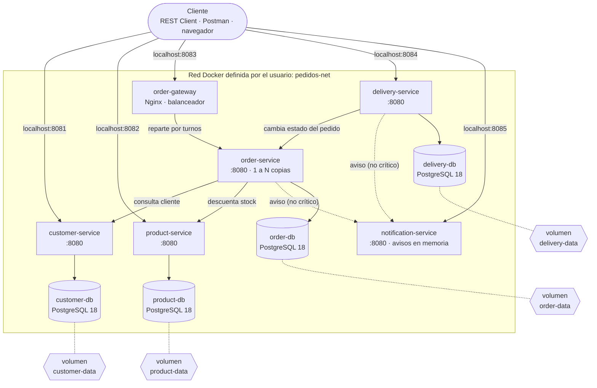

**Cómo leerlo:**

- El cliente entra **solo** por los puertos publicados. Dentro de `pedidos-net`, los servicios se llaman **por su nombre** (por ejemplo `http://customer-service:8080`) y todos escuchan en el 8080 de su propio contenedor.
- Cada servicio habla únicamente con **su** base de datos. Las bases no publican puertos hacia el exterior.
- Las bases guardan sus archivos en **volúmenes**, que sobreviven aunque los contenedores se eliminen.
- Las flechas punteadas hacia `notification-service` son dependencias **no críticas**.

### Puertos publicados hacia el exterior (punto 4)

| Contenedor | Puerto en tu PC | ¿Por qué? |
|---|---|---|
| `customer-service` | 8081 | El cliente lo usa directamente. |
| `product-service` | 8082 | El cliente lo usa directamente. |
| `order-gateway` | 8083 | Es la única entrada a `order-service` y reparte entre sus copias. |
| `delivery-service` | 8084 | El cliente lo usa directamente. |
| `notification-service` | 8085 | Para consultar los avisos enviados. |
| Copias de `order-service` | — | Solo se llega a ellas a través del gateway. Así se pueden escalar sin choques de puertos. |
| Las 4 bases de datos | — | Solo las usa su servicio, dentro de la red. Publicarlas sería una puerta abierta innecesaria. |

---

## 4. Diagrama de comunicación entre microservicios

Todas las llamadas son **HTTP síncronas con JSON**: quien llama espera la respuesta antes de continuar.

### 4.1 Crear un pedido

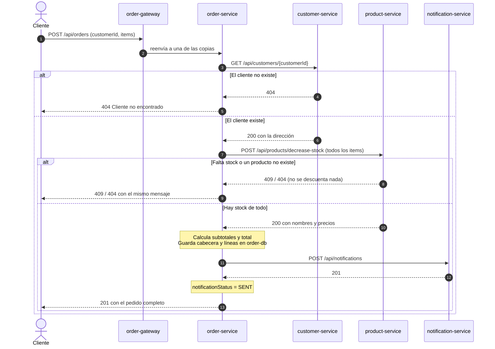

### 4.2 Registrar y completar una entrega

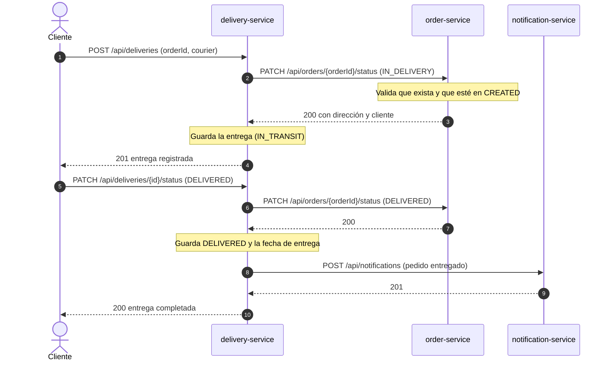

Solo `delivery-service` llama a `order-service`, nunca al revés, así que las dependencias no forman un círculo. Primero se actualiza el pedido y después la entrega: si `order-service` no responde, la entrega no cambia y nunca quedan dos estados contradictorios.

### 4.3 Escenario de fallo: `notification-service` detenido

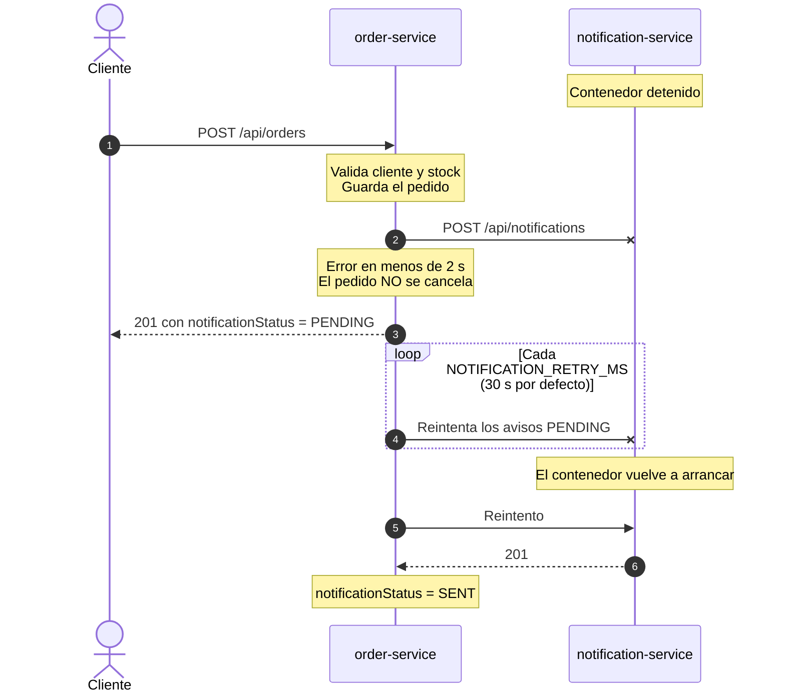

### 4.4 Tipos de dependencia

| Servicio que llama | Llama a | Tipo | Si no responde |
|---|---|---|---|
| `order-service` | `customer-service` | Crítica | El pedido se rechaza con **503** |
| `order-service` | `product-service` | Crítica | El pedido se rechaza con **503** |
| `order-service` | `notification-service` | No crítica | El pedido se crea con el aviso `PENDING` y se reintenta |
| `delivery-service` | `order-service` | Crítica | La entrega no se registra ni cambia (**503**) |
| `delivery-service` | `notification-service` | No crítica | La entrega se completa igual; el error queda en el log |

---

## 5. Endpoints de cada microservicio

Todos los servicios exponen además `GET /actuator/health`.

**customer-service** (`localhost:8081`)

| Método | Ruta | Descripción |
|---|---|---|
| POST | `/api/customers` | Registrar un cliente |
| GET | `/api/customers` | Listar clientes |
| GET | `/api/customers/{id}` | Consultar un cliente |
| PUT | `/api/customers/{id}` | Actualizar un cliente |
| DELETE | `/api/customers/{id}` | Eliminar un cliente |

**product-service** (`localhost:8082`)

| Método | Ruta | Descripción |
|---|---|---|
| POST | `/api/products` | Crear un producto |
| GET | `/api/products` | Consultar productos disponibles |
| GET | `/api/products/{id}` | Consultar un producto |
| PUT | `/api/products/{id}` | Actualizar un producto |
| POST | `/api/products/decrease-stock` | Descontar stock de varios productos en una transacción (lo usa `order-service`) |

**order-service** (`localhost:8083`, a través de `order-gateway`)

| Método | Ruta | Descripción |
|---|---|---|
| POST | `/api/orders` | Crear un pedido con uno o varios productos |
| GET | `/api/orders` | Listar pedidos |
| GET | `/api/orders/{id}` | Consultar el estado de un pedido |
| PATCH | `/api/orders/{id}/status` | Cambiar el estado (lo usa `delivery-service`) |

**delivery-service** (`localhost:8084`)

| Método | Ruta | Descripción |
|---|---|---|
| POST | `/api/deliveries` | Registrar la entrega de un pedido |
| GET | `/api/deliveries` | Listar entregas |
| GET | `/api/deliveries/{id}` | Consultar una entrega |
| PATCH | `/api/deliveries/{id}/status` | Marcar la entrega como `DELIVERED` |

**notification-service** (`localhost:8085`)

| Método | Ruta | Descripción |
|---|---|---|
| POST | `/api/notifications` | Enviar un aviso (se registra en el log) |
| GET | `/api/notifications` | Ver los últimos 100 avisos enviados |

**Códigos de respuesta usados:** 200, 201, 204, 400 (datos inválidos), 404 (no existe), 409 (conflicto: stock insuficiente o cambio de estado no permitido) y 503 (dependencia crítica caída). Los errores se devuelven en formato `application/problem+json` (RFC 9457).

Cada servicio incluye un archivo `request.http` con ejemplos que se pueden ejecutar con la extensión REST Client de VS Code.

---

## 6. Cómo ejecutar el proyecto

### Requisitos

- **Docker Desktop**, con WSL 2 en Windows.
- Unos **8 GB de RAM** libres: la plataforma levanta 5 JVM, 4 bases PostgreSQL y Nginx.
- No hace falta tener Java ni Maven instalados: todo se compila dentro de Docker.

### Pasos

```bash
# 1. Clonar el repositorio
git clone https://github.com/VInnyLeo/gestion-pedidos-uce.git
cd gestion-pedidos-uce

# 2. Crear el archivo de configuración a partir del ejemplo
copy .env.example .env        # Windows
# cp .env.example .env        # Linux / macOS

# 3. Construir y levantar la plataforma
docker compose up -d --build

# 4. Verificar: los 9 contenedores con healthcheck deben quedar (healthy)
docker compose ps
```

El primer arranque tarda varios minutos, porque descarga las imágenes base y las dependencias de Maven. Los servicios arrancan en orden: cada uno espera a que sus dependencias estén **healthy**.

### Escalar `order-service`

```bash
docker compose up -d --scale order-service=3   # tres copias detrás de order-gateway
docker compose up -d --scale order-service=1   # volver a una copia
```

### Detener

```bash
docker compose down       # elimina los contenedores y la red; los datos se conservan
docker compose down -v    # además borra los volúmenes (se pierden todos los datos)
```

### Scripts de demostración (Windows PowerShell)

| Script | Qué demuestra |
|---|---|
| `scripts/demo-puntos-4-5-7.ps1` | Puertos publicados, persistencia al eliminar y recrear contenedores, y configuración sin reconstruir |
| `scripts/demo-punto-8-salud.ps1` | HEALTHCHECK y simulación de fallo de `customer-db` |
| `scripts/pruebas-funcionales.ps1` | 28 pruebas automáticas del flujo completo de negocio |
| `scripts/demo-escalabilidad.ps1` | 3 copias de `order-service` y balanceo de carga |

Se ejecutan desde la raíz del proyecto:

```powershell
powershell -ExecutionPolicy Bypass -File .\scripts\pruebas-funcionales.ps1
```

### Estructura del repositorio

```
gestion-pedidos-uce/
├── compose.yaml              # Definición completa de la plataforma
├── .env.example              # Variables de entorno de ejemplo (copiar como .env)
├── gateway/nginx.conf        # Balanceador de carga para order-service
├── scripts/                  # Scripts de demostración y pruebas funcionales
├── docs/evidencias/          # Capturas de las pruebas
├── customer-service/         # Cada servicio: Dockerfile, .dockerignore,
├── product-service/          #   pom.xml, request.http y src/ con las capas
├── order-service/            #   controller, service, repository, model,
├── delivery-service/         #   dto, exception y client
└── notification-service/
```

---

## 7. Configuración de Docker

### 7.1 Dockerfiles (punto 3)

Los cinco servicios usan el mismo `Dockerfile` **multistage**:

| Requisito del caso | Cómo se cumple |
|---|---|
| Imagen base adecuada | `eclipse-temurin:25-jdk` para compilar y `eclipse-temurin:25-jre` para ejecutar |
| Directorio de trabajo | `WORKDIR /app` |
| Copiar los archivos necesarios | Solo `.mvn/`, `mvnw`, `pom.xml` y `src/` |
| Instalar las dependencias | `./mvnw dependency:go-offline`, en una capa propia que Docker guarda en caché |
| Configurar la ejecución | `ENTRYPOINT ["java", "-jar", "app.jar"]` |
| Exponer el puerto | `EXPOSE 8080` |
| Evitar archivos innecesarios | `.dockerignore` excluye `target/`, `.vscode/`, `HELP.md` y `*.http`. La etapa final solo recibe el `.jar`. |
| Multistage build | La imagen final no contiene el JDK, Maven, el código fuente ni las librerías descargadas para compilar |

Además, el contenedor se ejecuta con un **usuario sin privilegios** (`app`) y tiene un `HEALTHCHECK`. La imagen incluye `curl` solo para ese chequeo, porque `eclipse-temurin:25-jre` no trae ningún cliente HTTP.

### 7.2 Red Docker (punto 4)

Una red definida por el usuario, `pedidos-net` (driver *bridge*), conecta los 11 contenedores. El DNS interno de Docker permite que los servicios se encuentren por nombre. Cuando `order-service` tiene varias copias, el nombre `order-service` resuelve a todas ellas.

### 7.3 Volúmenes (punto 5)

| Volumen | Base de datos | Ruta en el contenedor |
|---|---|---|
| `customer-data` | `customer-db` | `/var/lib/postgresql` |
| `product-data` | `product-db` | `/var/lib/postgresql` |
| `order-data` | `order-db` | `/var/lib/postgresql` |
| `delivery-data` | `delivery-db` | `/var/lib/postgresql` |

Desde PostgreSQL 18, la imagen oficial guarda sus datos en `/var/lib/postgresql`. Antes era `/var/lib/postgresql/data`.

`notification-service` guarda sus avisos **en memoria** de forma intencional: el caso exige persistencia para clientes, productos y pedidos. Esto sirve además de contraste: al reiniciarlo, sus avisos desaparecen y los datos de las bases no.

### 7.4 Variables de entorno (punto 7)

Ningún dato de configuración está fijo en el código. Spring Boot los lee con la sintaxis `${VARIABLE:valor_por_defecto}`.

| Variable | Servicios | Valor en Docker | Para qué |
|---|---|---|---|
| `DB_URL` | customer, product, order, delivery | `jdbc:postgresql://<servicio>-db:5432/<base>` | Conexión a su base de datos |
| `DB_USER` / `DB_PASSWORD` | customer, product, order, delivery | Desde `.env` | Credenciales de su base |
| `CUSTOMER_SERVICE_URL` | order | `http://customer-service:8080` | Dirección de clientes |
| `PRODUCT_SERVICE_URL` | order | `http://product-service:8080` | Dirección de productos |
| `ORDER_SERVICE_URL` | delivery | `http://order-service:8080` | Dirección de pedidos |
| `NOTIFICATION_SERVICE_URL` | order, delivery | `http://notification-service:8080` | Dirección de notificaciones |
| `CLIENT_TIMEOUT_MS` | order, delivery | `2000` (por defecto) | Tiempo máximo de espera entre servicios |
| `NOTIFICATION_RETRY_MS` | order | Desde `.env` (por defecto `30000`) | Intervalo de reintento de avisos pendientes |
| `SERVER_PORT` | todos | `8080` (por defecto) | Puerto interno del servicio |

El archivo `.env`, con las credenciales, **no se sube** al repositorio (está en `.gitignore`). Se publica `.env.example` con valores de ejemplo.

**Demostración del punto 7:** se cambió `NOTIFICATION_RETRY_MS` de 30000 a 10000 solo en `.env`. Con `docker compose up -d`, **sin `--build`**, Docker recreó el contenedor con el valor nuevo usando la **misma imagen**. Ver las [evidencias 07](#punto-7-variables-de-entorno-sin-reconstruir).

### 7.5 Comprobaciones de salud (punto 8)

**Condición de servicio saludable:**

- **Microservicios:** `GET /actuator/health` responde `UP` (HTTP 200). Spring Boot Actuator incluye la conexión con la base de datos, así que si la base cae, el servicio responde `DOWN` (HTTP 503) aunque su proceso siga encendido.
- **Bases de datos:** `pg_isready` confirma que PostgreSQL acepta conexiones.

| Parámetro | Microservicios | Bases de datos |
|---|---|---|
| Comando | `curl -fs http://localhost:8080/actuator/health` | `pg_isready -U $POSTGRES_USER -d $POSTGRES_DB` |
| Intervalo | 15 s | 5 s |
| Timeout | 5 s | 5 s |
| Periodo de gracia al arrancar | 60 s | — |
| Reintentos para declararlo `unhealthy` | 3 | 10 |

Compose usa estos estados con `depends_on: condition: service_healthy`: `order-service` espera a que clientes y productos estén sanos, y `delivery-service` espera a `order-service`.

---

## 8. Evidencias

### Punto 3: imagen multistage

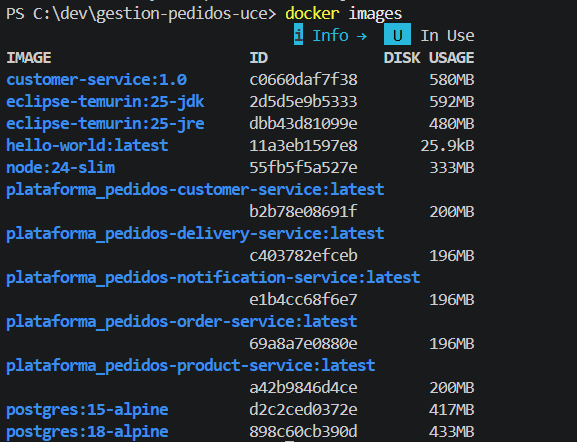

La imagen del servicio contiene el JRE y el `.jar`. Una imagen de una sola etapa incluiría además el JDK completo, Maven, el código fuente y todas las librerías descargadas para compilar.

### Punto 4: puertos publicados

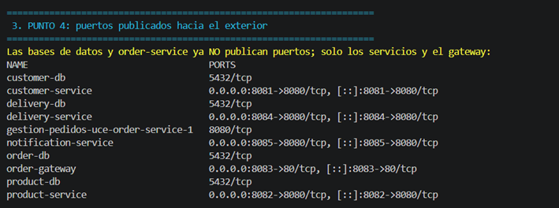

Las bases de datos y las copias de `order-service` muestran solo su puerto interno (`5432/tcp` y `8080/tcp`), sin publicar hacia `0.0.0.0`.

### Punto 5: persistencia al eliminar y recrear contenedores

| | |
|---|---|
| 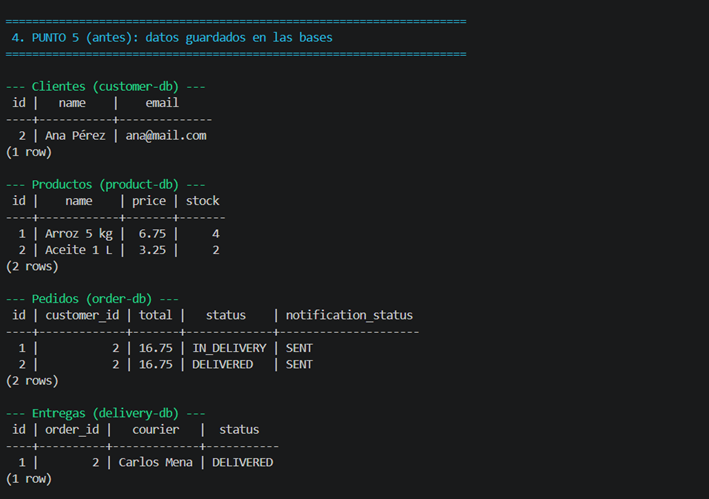 | 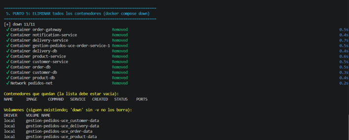 |
| **1.** Datos en las cuatro bases | **2.** `docker compose down`: no queda ningún contenedor, pero los volúmenes siguen |
| 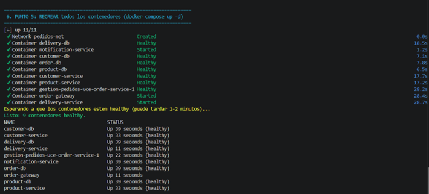 | 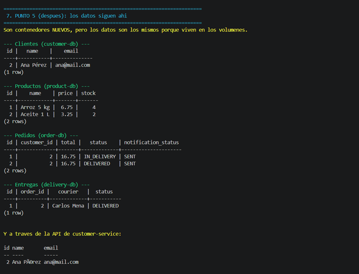 |
| **3.** `docker compose up -d`: contenedores nuevos | **4.** Los mismos datos en los contenedores nuevos |

### Punto 7: variables de entorno sin reconstruir

| | |
|---|---|
| 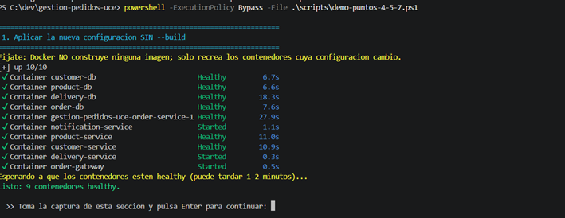 | 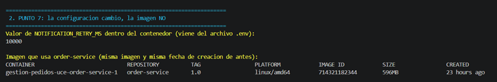 |
| `docker compose up -d` recrea los contenedores sin construir imágenes | `NOTIFICATION_RETRY_MS = 10000`, con la misma imagen `order-service:1.0` |

### Punto 8: comprobaciones de salud

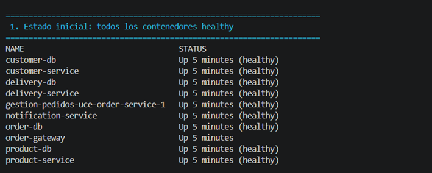

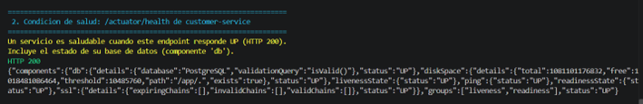

**Fallo simulado:** se detiene `customer-db`. A los 50 segundos `customer-service` pasa a **unhealthy**, responde **503**, y el resto de la plataforma sigue funcionando.

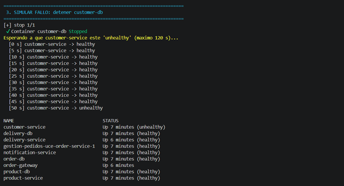

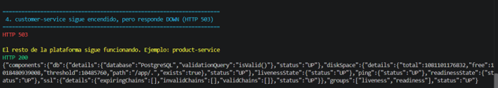

**Recuperación:** al encender `customer-db`, `customer-service` vuelve a **healthy** solo, sin reiniciarlo.

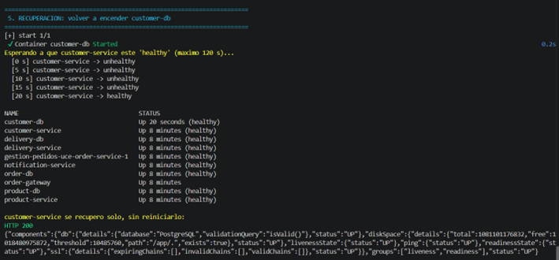

### Punto 9: pruebas funcionales

El script `scripts/pruebas-funcionales.ps1` recorre el flujo completo: clientes → productos → pedido → entrega → notificaciones. Incluye los casos de error. Resultado: **28 de 28 pruebas correctas**.

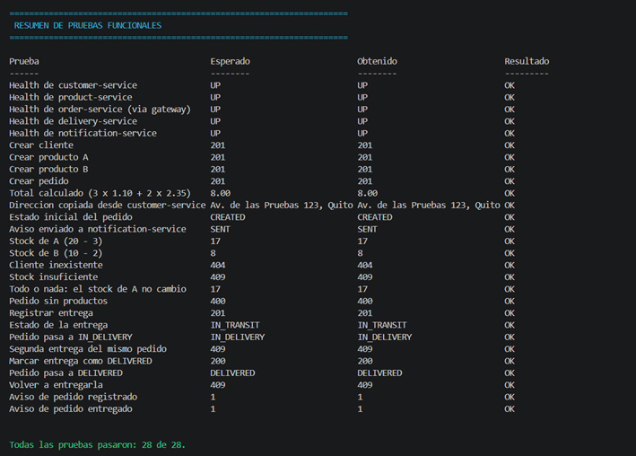

<details>
<summary>Detalle de la ejecución y pruebas adicionales</summary>

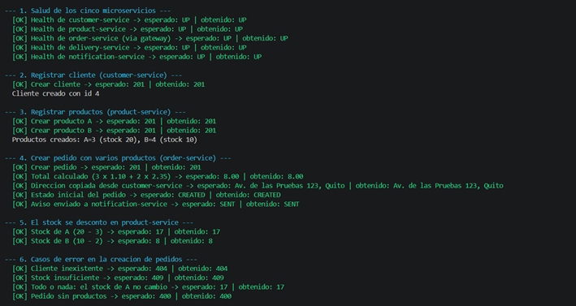

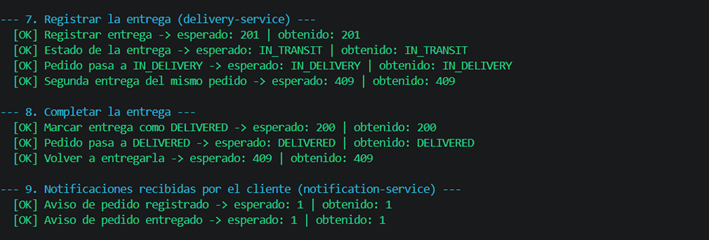

**Transacción "todo o nada":** tras un descuento fallido por falta de aceite, el stock del arroz no cambió.

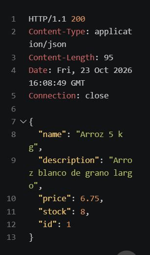

**Cambio de estado no permitido:** un pedido no puede volver de `IN_DELIVERY` a `CREATED`.

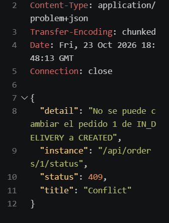

</details>

### Escalabilidad básica (objetivo del caso)

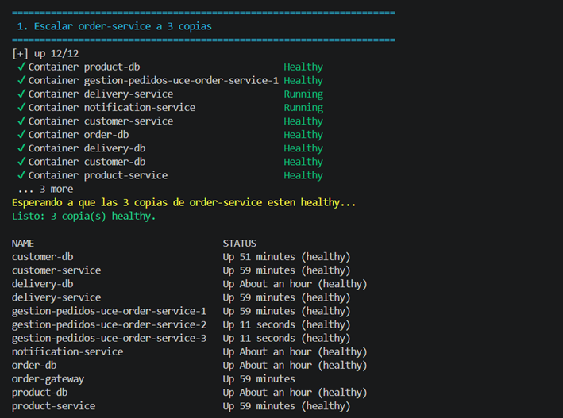

`order-gateway` reparte las peticiones por turnos entre las tres copias (cabecera `X-Served-By`):

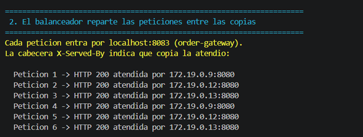

**Costo de escalar:** cada copia de `order-service` consume unos 330 MiB de memoria, mientras que Nginx usa unos 10 MiB.

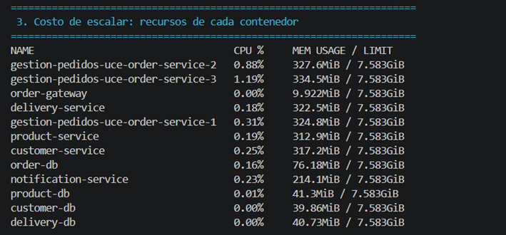

### Punto 10: escenario de fallo

Ver el análisis completo en la [sección 9](#9-análisis-del-escenario-de-fallo).

| | |
|---|---|
| 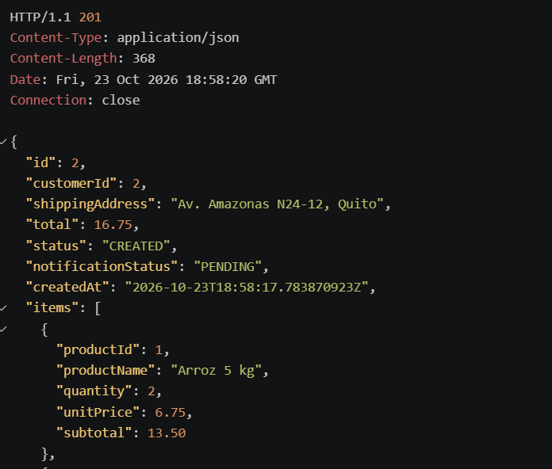 | 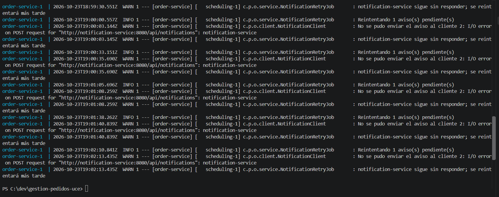 |
| **1.** Con `notification-service` detenido, el pedido se crea (**201**) con el aviso `PENDING` | **2.** El reintento automático falla mientras el servicio sigue caído |
| 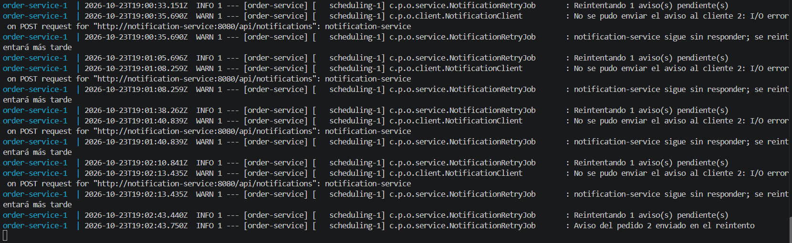 | 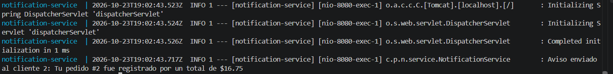 |
| **3.** Al volver el servicio, el reintento envía el aviso | **4.** `notification-service` recibe el aviso pendiente |

---

## 9. Análisis del escenario de fallo

**Escenario:** se detiene `notification-service` con `docker compose stop notification-service`.

| Pregunta del caso | Respuesta | Evidencia |
|---|---|---|
| ¿Qué funcionalidades continúan disponibles? | Todas las de negocio: registrar y consultar clientes y productos, crear y consultar pedidos, y registrar y completar entregas. | 10-1 |
| ¿Qué funcionalidad deja de funcionar? | Solo el envío de avisos a los clientes y la consulta de avisos enviados. | 10-2 |
| ¿La creación de pedidos continúa? | **Sí.** Las notificaciones son una dependencia no crítica: el pedido se guarda y responde 201 con `notificationStatus = PENDING`. | 10-1 |
| ¿Qué debería ocurrir cuando el servicio vuelva? | Una tarea programada de `order-service` busca los pedidos `PENDING` cada `NOTIFICATION_RETRY_MS`, reenvía los avisos y los marca como `SENT`, **sin intervención manual**. En la evidencia, el aviso llegó 300 ms después de que el servicio volvió. | 10-3, 10-4 |

**Comparación con una dependencia crítica:** si se detiene `customer-service`, la creación de pedidos **sí** se detiene y responde **503**, porque no se puede validar al cliente. El sistema distingue entre lo imprescindible y lo que puede esperar.

---

## 10. Limitaciones y mejoras futuras

| Limitación | Mejora propuesta |
|---|---|
| Si `product-service` descuenta el stock y `order-service` falla antes de guardar el pedido, el stock queda descontado sin pedido. | Patrón **Saga**, con acciones compensatorias que devuelvan el stock. |
| Un aviso puede enviarse dos veces si la respuesta se pierde por timeout (entrega *at-least-once*). Con varias copias de `order-service`, dos pueden reintentar el mismo aviso. | Enviar los avisos por una **cola de mensajes** (RabbitMQ o Kafka), o usar un bloqueo distribuido para la tarea programada. |
| Los avisos de entrega no se reintentan si `notification-service` está caído. | Guardar su estado y reintentarlos, igual que los avisos de pedido. |
| `notification-service` guarda los avisos en memoria, así que no puede escalarse ni conservarlos al reiniciarse. | Darle su propia base de datos si el negocio lo requiere. |
| Las tablas se crean con `ddl-auto: update`. | Usar migraciones versionadas con **Flyway** o **Liquibase**. |
| Las credenciales están en un archivo `.env`, adecuado solo para desarrollo. | Usar Docker secrets o un gestor de secretos. |
| Compose orquesta en una sola máquina. | Desplegar en **Kubernetes**, con escalado automático (HPA) y *liveness/readiness probes*, que Actuator ya expone. |
